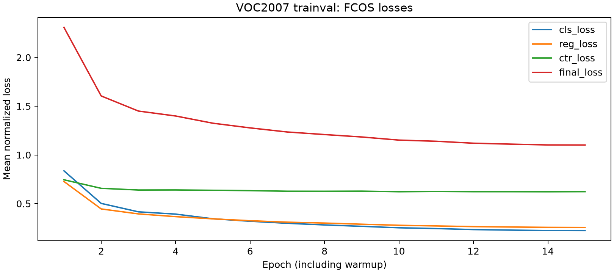
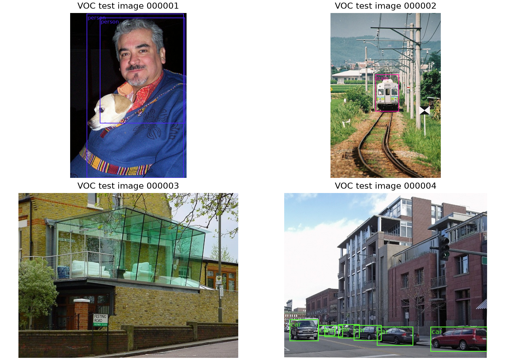

# Transformer block and FCOS: methods and measured results

**Sean Chang (GitHub: seanchang1529)** | BMI / CS 771 Assignment 2 | Detection component (6 points)

This component covers the TransformerBlock review (1 point), FCOS inference (2 points), and multitask loss/training/evaluation (3 points). It is prepared for integration with Matej Popovski's classification component. AI assistance and actual work are described below.

**Status:** Required experiment artifacts are present; review still required.

## TransformerBlock review

The existing block was independently checked without changing its forward behavior or parameter shapes. For input X in (batch, height, width, channels) order, its residual equations are `Y = X + DropPath(Attention(LN1(X)))` and `Z = Y + DropPath(MLP(LN2(Y)))`. Normalization precedes both learned branches (Pre-LN). A positive window size restricts attention to nonoverlapping spatial windows; zero selects global attention. Spatial padding is added after LN1, then removed before the attention residual is added. The supplied padding convention uses zero tokens without an attention mask. This was preserved for checkpoint compatibility.

Stochastic depth samples one keep/drop decision per original image and residual branch, broadcasts it over all spatial positions and channels, and divides kept branches by the keep probability [3]. It is applied after windows are reassembled, so separate windows from one image share a decision. The two calls draw independent masks. Evaluation disables stochastic depth. The added tests compare outputs and input gradients with an explicit window-loop oracle, verify zero cross-window gradients, and check image-level masks on padded, rectangular inputs. No saved ViT checkpoint has been modified.

## FCOS inference

PointGenerator stores (y, x), whereas boxes use (x, y). At each FPN level, class and centerness logits are passed through sigmoid and combined as sqrt(p_class * p_center). Thresholding and top-K selection operate on class-location pairs, allowing multiple class hypotheses at one location. Predicted (left, top, right, bottom) distances are multiplied by stride and decoded around the location. Boxes are clipped to resized image bounds; dimensions at most 0.01 pixel are rejected. Class-aware NMS is applied across levels, followed by the per-image limit. Labels receive +1 for the supplied COCO-format category IDs, and boxes are rescaled to original image dimensions.

## FCOS assignment and multitask loss

A location must lie strictly inside a ground-truth box and its clipped center-sampling region. The region extends center_sampling_radius times the level stride from the box center. The maximum pixel distance to the box sides must fall within that level's configured regression range. The smallest-area eligible ground-truth box wins overlaps. Class targets are zero-based; unmatched locations use an all-zero class vector. Regression targets are side distances divided by stride.

The loss sums sigmoid focal classification (alpha 0.25, gamma 2) over all locations, unweighted GIoU regression over positives, and BCE-with-logits centerness over positives. The centerness target is sqrt(min(l,r)/max(l,r) * min(t,b)/max(t,b)). Each loss is normalized by the starter's EMA of positive counts (initial value 100, momentum 0.9, lower bound 1). Empty-positive batches retain classification loss and differentiable zero regression/centerness losses. Assignment is vectorized over locations and boxes, with only the image dimension looped.

## Data and training protocol

Only the supplied VOC2007 trainval annotations (5,011 images) may be used for training; all 4,952 test images are reserved for evaluation. The preflight audit verifies image counts, category IDs, annotation references, image existence and disjoint filenames. The instructor detector is evaluated separately and is never loaded by train_det.py. Training initializes the ResNet-18 backbone from ImageNet; FPN and detection heads start fresh. No torchvision or other external FCOS implementation is used.

The supplied FCOS architecture [4] uses ResNet-18 feature stages at strides 8, 16 and 32, a 128-channel FPN and two extra levels at strides 64 and 128. Shared classification and regression towers each contain three 3 x 3 convolution/GroupNorm/ReLU stages. Classification predicts 20 logits; the regression tower predicts nonnegative side distances and a centerness logit. The Pre-LN structure follows [2]; assignment-specific details are described from the reviewed source [1].

The resolved training configuration uses batch size 32, SGD learning rate 0.02, momentum 0.9, weight decay 0.0001, 3 warmup plus 12 cosine epochs, and seed 771. Short-side scale jitter is [288, 320, 352, 384, 416, 448, 480] with maximum long side 640. Backbone BN freezing is False. CUDA training uses fp16; evaluation uses FP32.

## Results

| Detector | AP50 | AP50:95 | Images |
| --- | ---: | ---: | ---: |
| Instructor checkpoint (evaluation only) | 60.69% | 32.80% | 4952 |
| Independently trained FCOS | 60.52% | 32.42% | 4952 |

Reference: data-loop time 126.99 seconds, 39.00 images/second; full evaluation including COCOeval 177.70 seconds.

Synchronized model time: 102.66 seconds (48.24 images/second), device cuda:0, GPU Tesla T4, PyTorch 2.11.0+cu130. This includes model preprocessing, backbone, heads, decode/NMS and resizing boxes back; it excludes data loading, host transfers, visualization and COCOeval. The cold first batch is included. Data-loop time includes those loading/transfer/visualization costs.

Trained detector: data-loop time 108.22 seconds, 45.76 images/second; full evaluation including COCOeval 158.02 seconds.

Synchronized model time: 83.60 seconds (59.24 images/second), device cuda:0, GPU Tesla T4, PyTorch 2.11.0+cu130. This includes model preprocessing, backbone, heads, decode/NMS and resizing boxes back; it excludes data loading, host transfers, visualization and COCOeval. The cold first batch is included. Data-loop time includes those loading/transfer/visualization costs.

The independently trained detector differs from the fixed reference by -0.17 AP50 percentage points. This is a single-seed experiment; the reference is a correctness check, not an independently trained result.

Evaluation batch sizes differ: reference 8, trained detector 32. Both use the same architecture. The throughput difference is therefore not evidence that the learned model is intrinsically faster. Batch size, startup, caching and the number of candidate detections affect these measured timings.

Recorded training: 15 epochs; summed epoch wall time 31.47 minutes. Final normalized total loss: 1.1013.

Classification loss falls from 0.8365 to 0.2231, and regression loss from 0.7269 to 0.2555. Centerness BCE changes from 0.7447 to 0.6227 and plateaus earlier. Its targets are continuous values, so a positive BCE floor is expected. The training curves show stable optimization, but cannot establish overfitting or statistical significance from one final test evaluation. No test-set curve was used to select a checkpoint.

Examples use the first test images in deterministic loader order, with a display threshold of 0.5. AP uses every image and the configured score threshold 0.1; NMS IoU is 0.6.

## Qualitative analysis

The four displayed images are a fixed selection, rather than examples chosen for
success. Image 000001 illustrates occlusion and threshold effects: the trained
model displays one person box (score 0.7033), while the reference displays two
overlapping person boxes (0.6878 and 0.5277). Both produce dog candidates below
the display threshold: the highest dog score is 0.4523 for the trained detector
and 0.4997 for the reference. Thus, an absent displayed dog box does not mean
the prediction is absent from AP evaluation.

In image 000002, the reference displays a train at score 0.5425. The trained
detector's highest train score is 0.4893, narrowly below the 0.5 display cutoff.
It is still included among predictions scored by the AP evaluator at threshold
0.1. Image 000003 shows furniture behind glass, and neither model displays a
box above 0.5; occlusion, reflections and small objects remain challenging.
In image 000004, both models localize multiple cars. The trained detector
displays six car boxes and the reference seven, including overlapping hypotheses
among the distant vehicles. A relatively permissive NMS IoU of 0.6 can retain
boxes whose overlap does not exceed that threshold.

These examples show that similar aggregate AP50 can coexist with different
confidence calibration and individual detections. They cannot establish a
general improvement or degradation by themselves. The full-test result is
60.52% AP50 for the trained detector versus 60.69% for the instructor reference,
a difference of -0.17 percentage points in this single-seed experiment.

## Artifact verification

The detector audit passes: strict saved-config checkpoint loading, finite tensors, all 15 scheduled epochs, 12 matched sample images per detector, and nonempty TensorBoard scalar streams. Recomputing COCO AP from the transferred prediction JSON files and the original test annotations reproduces the reported AP/AP50/AP75 exactly.

The trained checkpoint differs from the instructor checkpoint in 146 floating tensors. The exact SHA-256 digests are recorded in results/detection_review/detector_audit.json.

## Verification, provenance and remaining review

Existing code was preliminary and AI-assisted. This work independently reviewed the assigned paths, added mathematical/behavioral tests, fixed stale reference reuse and measurement provenance, verified evaluation coverage, bounded sample rendering, and made checkpoint writes atomic. TransformerBlock and Matej's classifier artifacts were preserved. Test and package-version records are under results/detection_review/. Sean Chang executed the Colab training/evaluation workflow and transferred the saved artifacts. Codex assisted with independent review of preliminary code, tests, workflow changes, artifact audits and this report section. Preliminary model code existed before this work; no new human authorship is claimed for that scaffolding. Personal understanding and team cross-review still require confirmation under the course's applicable assistance policy.

Additional common tools are pytest for tests, matplotlib for plots, reportlab for PDF generation, and pypdf for PDF inspection. TensorBoard event parsing uses the assignment's required tensorboard package. Exact cloud and local package versions are retained with the component artifacts.

Matej should review target assignment/loss conventions, the trainval/test audit, checkpoint provenance, the real detection results and the report section before integration. The combined PDF, team contribution confirmation and final ZIP audit remain separate team steps. No merge or Canvas submission is performed by this workflow.

## Sources

[1] BMI / CS 771 Fall 2026 Assignment 2 release: readme, starter code, VOC annotations and instructor checkpoint. The component also preserves attribution in the supplied loss and window helper files.

[2] Xiong et al. On Layer Normalization in the Transformer Architecture. ICML, 2020. https://arxiv.org/abs/2002.04745

[3] Huang et al. Deep Networks with Stochastic Depth. ECCV, 2016. https://arxiv.org/abs/1603.09382

[4] Tian et al. FCOS: A simple and strong anchor-free object detector. Journal-version manuscript, 2020. https://arxiv.org/abs/2006.09214
